# G-HUIM

For 2026 DASFAA paper please refer to the following commit:
[b08df0c](https://github.com/Tarun-Sreepada/G-HUIM/commit/b08df0c2de23f2949935fc2522f66ff672a396b7)

Project in its current state has been improved with several optimizations, along with a multi-threaded CPU miner implementation as well.

GPU-accelerated High-Utility Itemset Mining on NVIDIA hardware (`G-HUIM/`), plus a CPU miner, REFIM (`REFIM/`).

---

## Requirements

- CUDA toolkit 12.x, an sm_80 or newer GPU (G-HUIM only). The persistent engine groups blocks into
  thread-block clusters with DSMEM stealing on sm_90+; on sm_80/sm_86 each block is its own cluster
- CMake ≥ 3.24, a C++20 host compiler and NVCC
- Network on first configure: pinned CLI11 and spdlog are fetched

---

## Configure & Build

```bash
cmake -S . -B build -DCMAKE_BUILD_TYPE=Release
cmake --build build -- -j"$(nproc)"
```

Produces `build/G-HUIM` and `build/REFIM`. To build just one miner from the root:

```bash
cmake -S . -B build -DHUIM_BUILD_GHUIM=OFF   # REFIM only (no CUDA needed)
cmake -S . -B build -DHUIM_BUILD_REFIM=OFF   # G-HUIM only
```

Each project also builds alone
(`cmake -S G-HUIM -B build-ghuim`, `cmake -S REFIM -B build-refim`). The GPU architecture is
auto-detected; override with `-DCMAKE_CUDA_ARCHITECTURES=...`.

---

## REFIM (CPU)

Multi-threaded CPU miner (refined EFIM). Workers are pinned to cores and steal work nearest-first.

```bash
./build/REFIM -h
./build/REFIM -i datasets/accidents_utility_spmf.txt -m 3000000 -t 0              # count only, all cores
./build/REFIM -i datasets/accidents_utility_spmf.txt -m 3000000 -t 16 -o out.txt  # write itemsets
```

| Option | Meaning |
| --- | --- |
| `-i`, `--input`, `-m`, `--minutil` | SPMF dataset and minimum utility (required) |
| `-o`, `--output` | Write itemsets; omit (or `/dev/null`) to only count |
| `-t`, `--threads` | Worker threads (default 1, `0` = all) |
| `-n`, `--numa` | `on` (default): pin workers and place memory per NUMA node |
| `-v`, `--simd` | `auto` (default), `avx512` or `scalar` |
| `-p`, `--thp` | Transparent huge pages: `auto` (default), `on` or `off` |
| `-r`, `--refine` | Rounds of re-bounding each child without the items it rules out (`-1` = until none, `0` = off) |
| `-s`, `--separator`, `-l`, `--log-level`, `-L`, `--log-file` | Field separator (default space), logging |

`-l debug` prints reader phase times and per-worker steal counts.

---

## G-HUIM (GPU)

```bash
./build/G-HUIM -h
./build/G-HUIM -i datasets/accidents_utility_spmf.txt -m 3000000                  # count only
./build/G-HUIM -i datasets/accidents_utility_spmf.txt -m 3000000 -o results.txt   # write itemsets (BFS)
./build/G-HUIM -i datasets/accidents_utility_spmf.txt -m 3000000 -e dfs -M static -b 128
```

| Option | Meaning |
| --- | --- |
| `-i`, `--input`, `-m`, `--minutil` | SPMF dataset and minimum utility (required) |
| `-e`, `--search` | `bfs` (default, level by level) or `dfs` (task stack) |
| `-M`, `--method` | `adaptive` (default), `static`, `staged` or `tile` (last two BFS only) |
| `-b`, `--block-size` | Threads per task for `static` (32-1024, default 256) |
| `-g`, `--total-memory` | Device memory for projected databases (`K`/`M`/`G`); default uses free memory |
| `-C`, `--stack-capacity` | Most tasks one level may hold (BFS); default derived from device memory |
| `-o`, `--output` | Write itemsets (BFS only); without it they are only counted |
| `-s`, `--separator`, `-r`, `--refine`, `-l`, `--log-level`, `-L`, `--log-file` | Separator, bound refinement rounds, logging |

How it works:

- **Task** = a prefix itemset plus one extension item, with its projected database stored in a GPU memory arena.
- **BFS** runs every task of a level before the next level; **DFS** pops tasks from a stack.
- Each task makes passes over its transactions: local utilities, pruning by `--minutil` and renaming, writing the child database (identical transactions merged), and emitting child tasks.
- **`adaptive`** bins tasks by size and gives each bin its own kernel on its own stream (lane groups, a warp, a block, or many blocks per task). **`static`** gives every task one fixed-size block.
- Small subtrees can be finished inside a lane group without allocating child databases, and large sparse databases get occurrence indexes.
- Memory is planned from free device memory and your `--total-memory` / `--stack-capacity`; no fixed task cap.

---

## Verify

Check results against the CPU baseline (all search/method pairs must match REFIM's count):

```bash
python3 experiments/compare_counts.py datasets/accidents_utility_spmf.txt 3000000
```

---

## Experiments

`experiments/sweep.py` runs REFIM and G-HUIM one after another (so energy is not shared) over a minutil ladder per
dataset, 2 repetitions each, and writes `experiments/results/sweep.csv`. `experiments/plot_sweep.py` plots it.

```bash
python3 experiments/sweep.py                 # all datasets, ~30 min; --only chess,connect for a subset
python3 experiments/plot_sweep.py
```

Measured per run: miner runtime, itemset count, host peak RSS (G-HUIM also device arena + scratch), and energy
(CPU package energy via `perf stat`, plus GPU board energy for G-HUIM). A G-HUIM run that fails (BFS arena exhausted)
is plotted as a red cross, "didn't run".

| Runtime | Itemsets |
| --- | --- |
| [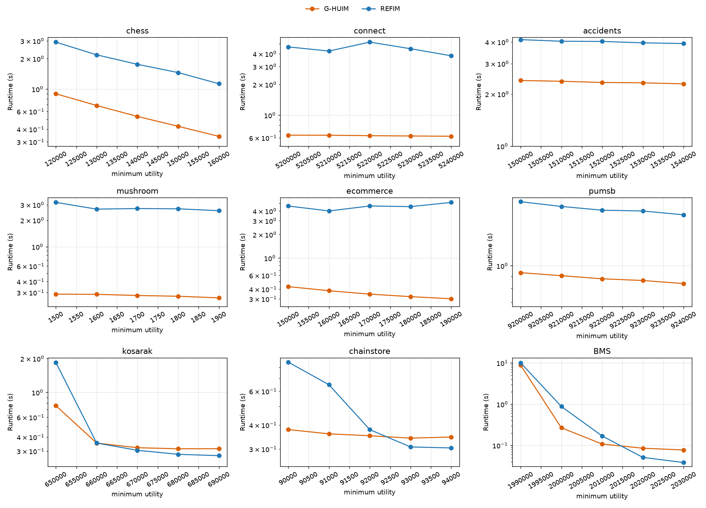](experiments/plots/sweep/runtime.png) | [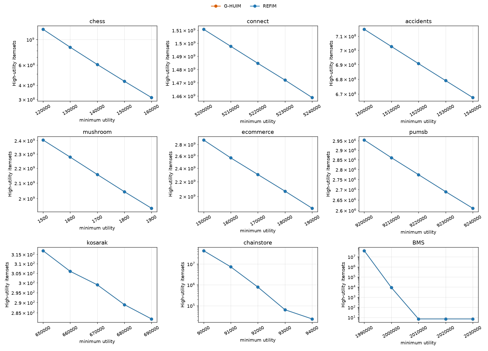](experiments/plots/sweep/patterns.png) |
| **Memory** | **Energy** |
| [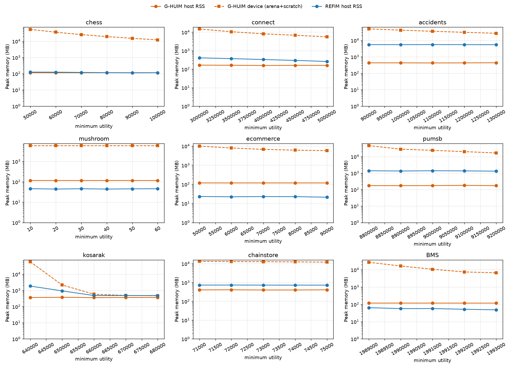](experiments/plots/sweep/memory.png) | [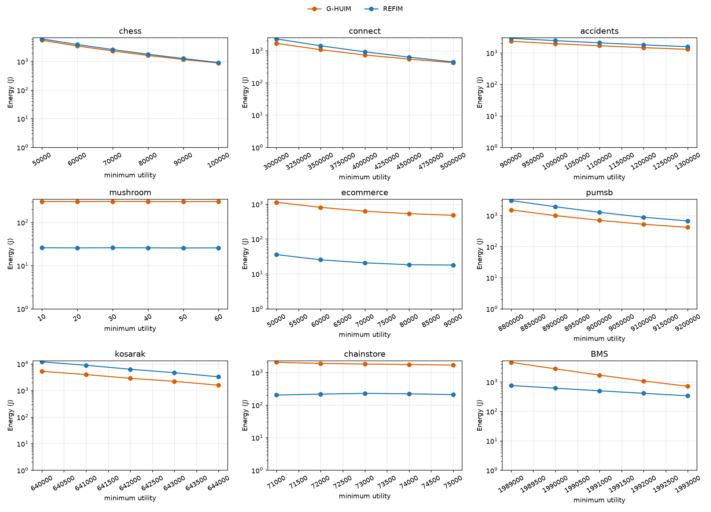](experiments/plots/sweep/energy.png) |

Recommended starting values (lowest minutil, then step up); each puts one miner at roughly 1-5 s on an H100 + 48-core host:

| Dataset | Start minutil | Step |
| --- | --- | --- |
| chess | 120000 | 10000 |
| connect | 5200000 | 10000 |
| accidents | 1500000 | 10000 |
| mushroom | 1500 | 100 |
| ecommerce | 150000 | 10000 |
| pumsb | 9200000 | 10000 |
| kosarak | 650000 | 10000 |
| chainstore | 90000 | 1000 |
| BMS | 1990000 | 10000 |

Notes: the default BFS runs out of arena memory on deep datasets at lower minutils (retail below ~1450, BMS below
~1.99M, chainstore at 70000), and REFIM needs 30 s+ there; REFIM cannot read `fruithut_utility.txt` (`@ITEM` headers).
Energy readings include other users' load on a shared host.

---

## Microbenchmarks

`microbenchmark/` has 14 small CUDA programs, one folder each (`NN_name/main.cu`), that check individual G-HUIM
design choices in isolation. Each prints CSV with an `ok` column (all variants must compute the same result);
a full run takes about 90 s on an H100, most of it the device-`malloc` runs in 12.

```bash
microbenchmark/run_all.sh            # build + run all; results/NN_name.csv   (or: run_all.sh 03 07)
.venv/bin/python microbenchmark/plot_all.py   # plots/NN_name.png
```

`run_all.sh` builds with `nvcc -arch=sm_90` (`ARCH=sm_80` etc. to change), uses `CUDA_VISIBLE_DEVICES=0` unless set,
and wraps each program in `timeout` (`LIMIT`, default 60 s). Shared helpers are in `microbenchmark/common/bench.cuh`.
`thread_usage.cu` is the older block-size vs `__syncthreads` benchmark.

| # | Question | Result on H100 PCIe |
| --- | --- | --- |
| 01 | Does the warp-wide tile layout coalesce? | Tiled (stride 8-32) scans at ~1.7 TB/s; contiguous falls to 450 GB/s at length 2048 |
| 02 | Best item search in a sorted transaction | Thread binary search wins from 16 queries/tx; warp two-level wins at 1 query; linear scan loses fast with length |
| 03 | Cost of the `rename[]` gather | ~145 Glookups/s while the table fits cache, 27 at 64 MB; copying a 128 KB table to shared memory per block is 3x slower than global |
| 04 | `cp.async` ring depth | Depth 3 reaches 1.75 TB/s vs 0.47 TB/s direct; depth 4 adds nothing |
| 05 | When is staging worth it | `cp.async` staging wins at every reuse level (up to ~2x); plain staging only at reuse 8-16 |
| 06 | Thread, warp or block per transaction | Thread wins at length 8, warp from ~64 (6x at 4096), block never |
| 07 | Occupancy vs block size and shared memory | Latency-bound kernel slows as shared memory cuts resident blocks (occupancy API shown alongside) |
| 08 | Scheduling skewed (Zipf) task sizes | Persistent blocks beat block-per-task at low skew; warp queues are ~4x worse at high skew; largest-first barely helps |
| 09 | Utility accumulation under contention | Shared-memory counters 10-100x faster than global atomics up to 4096 counters |
| 10 | Output append | Block-scan append 4-5x faster than per-item atomics from 5% density; warp aggregation adds nothing over the compiler's own |
| 11 | Copy / compute overlap | 2+ streams overlap well (combined time ~ copy time); one stream serialises |
| 12 | Allocator | Bump arena ~10^4 x faster than device `malloc` |
| 13 | Tensor-core equality (`[k\|~k]` AND+popc) | ~10% slower than plain 64-bit compares, so not worth it for lookups |
| 14 | Does L2 compression shrink tile padding? (`cuMemCreate` + `COMP_GENERIC`) | Zero rows: reads speed up with padding (+15% at 25%, +35% at 50%, 1.8x all-zero); zero lanes only help once a 128 B line is ~75% zero; scattered 4 B tile writes stay at ~30 GB/s either way |


| | |
| --- | --- |
| **Tiled vs contiguous layout**<br>[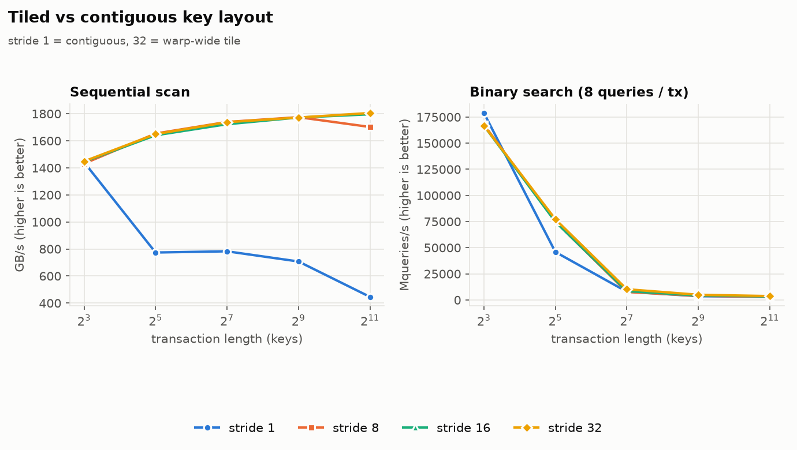](microbenchmark/plots/01_tiled_layout.png) | **Item search in a transaction**<br>[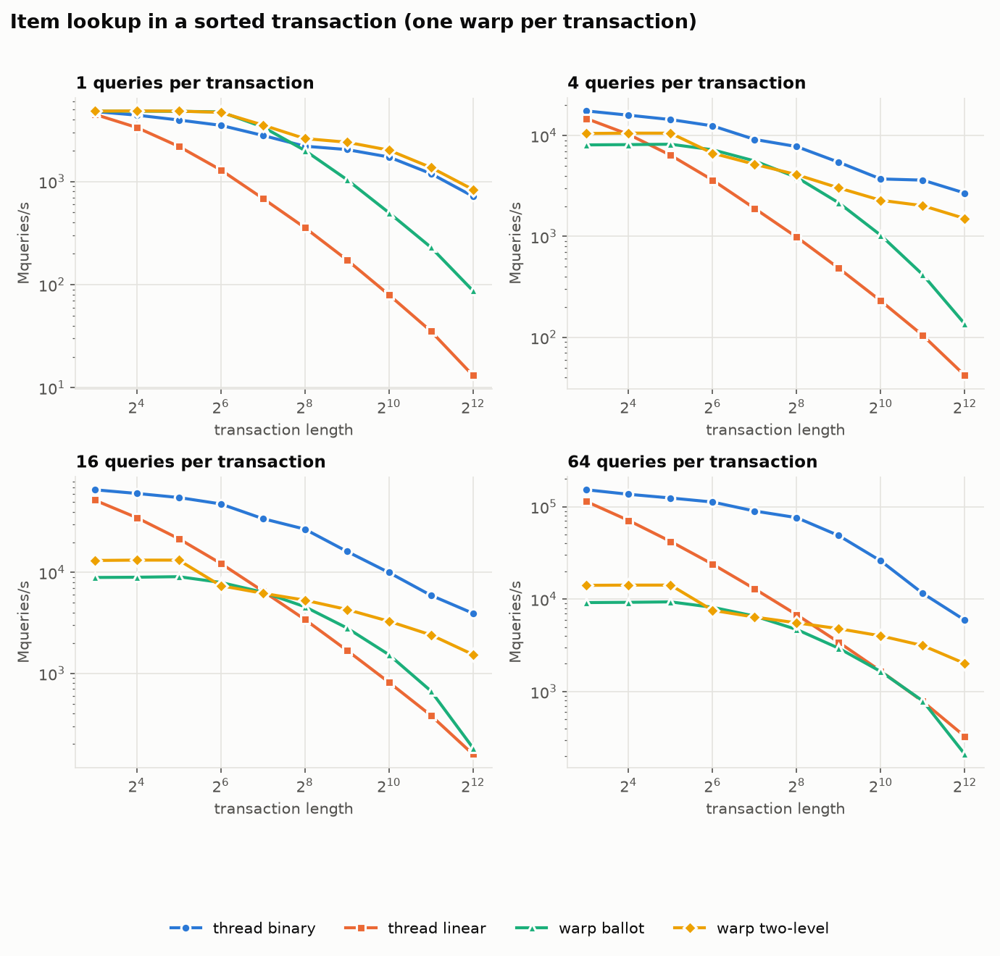](microbenchmark/plots/02_search_methods.png) |
| **`rename[]` gather**<br>[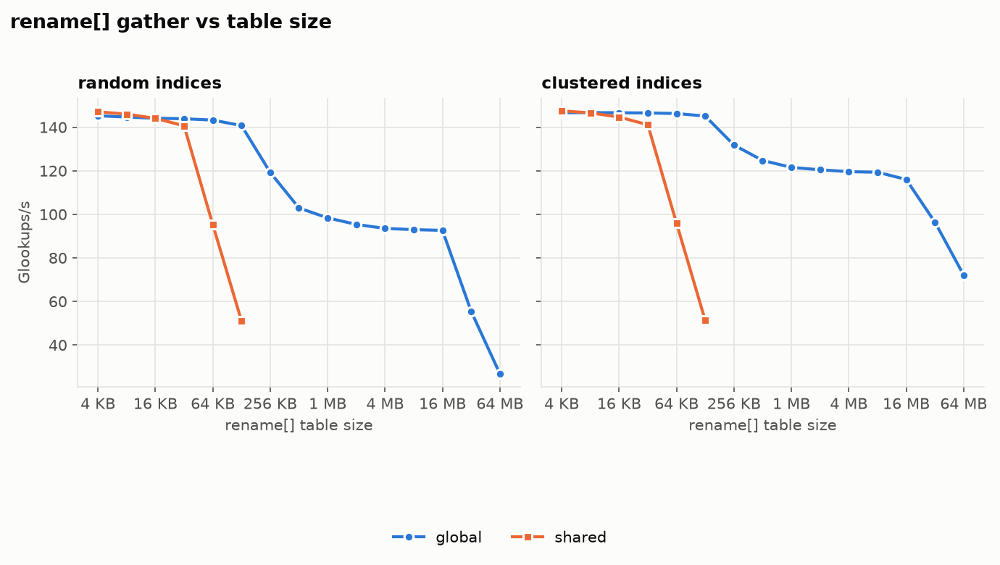](microbenchmark/plots/03_rename_gather.png) | **`cp.async` ring depth**<br>[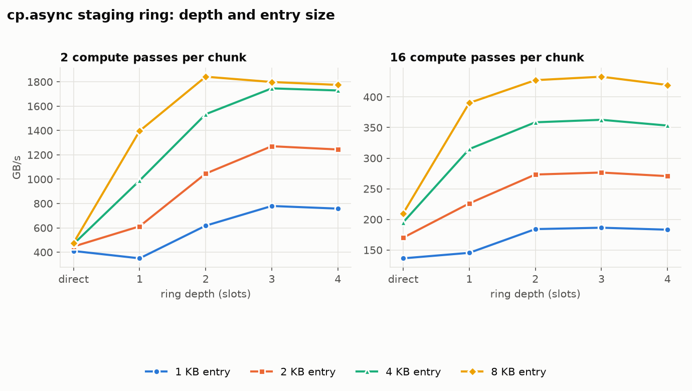](microbenchmark/plots/04_cp_async_ring.png) |
| **Staging vs direct reads**<br>[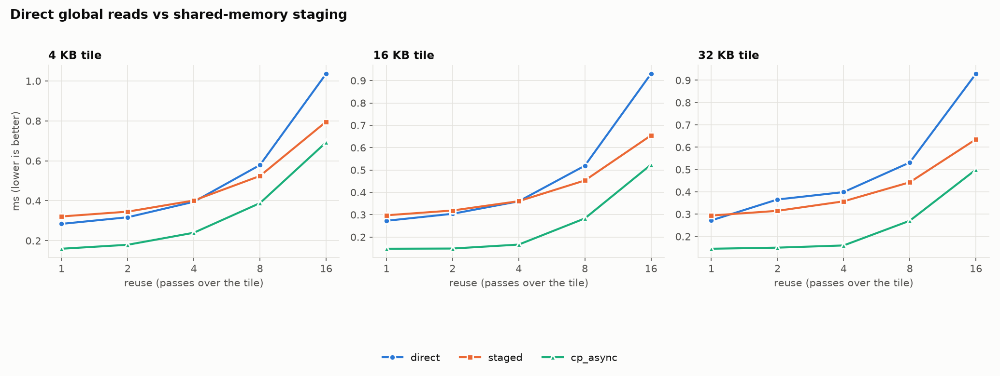](microbenchmark/plots/05_staging_reuse.png) | **Thread / warp / block per transaction**<br>[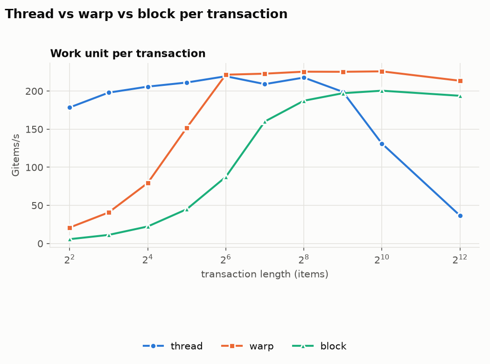](microbenchmark/plots/06_thread_warp_block.png) |
| **Occupancy**<br>[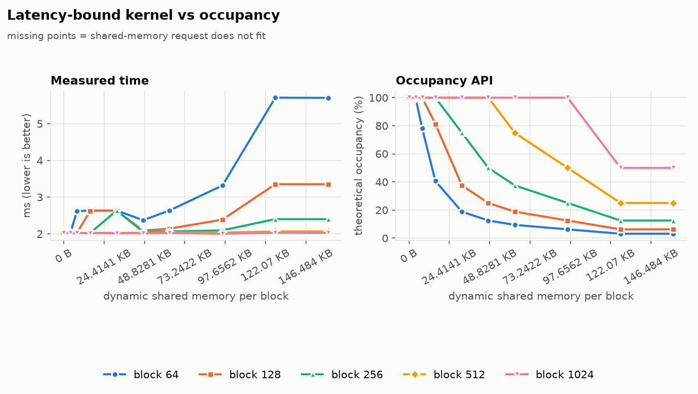](microbenchmark/plots/07_occupancy.png) | **Scheduling skewed tasks**<br>[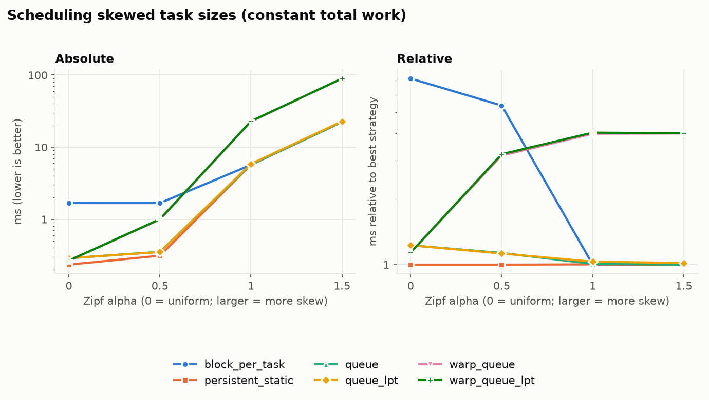](microbenchmark/plots/08_load_imbalance.png) |
| **Utility accumulation**<br>[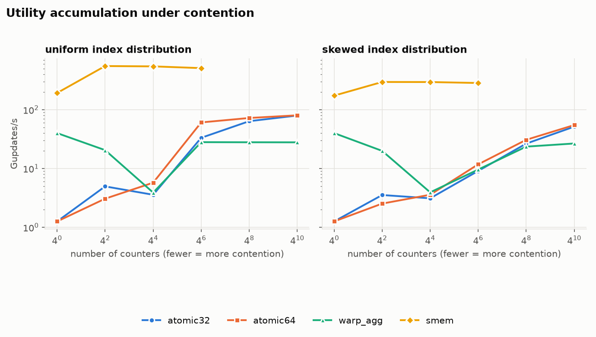](microbenchmark/plots/09_utility_accum.png) | **Output append**<br>[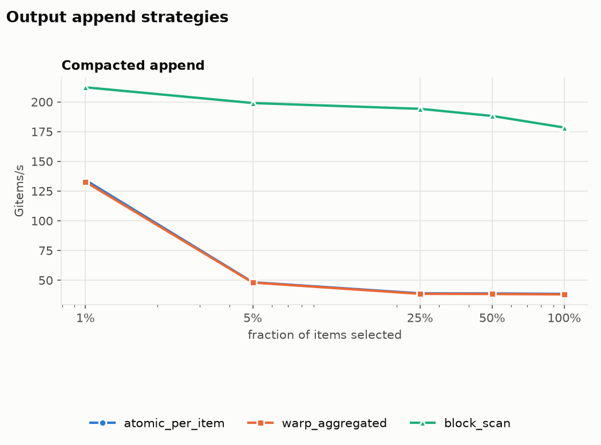](microbenchmark/plots/10_output_append.png) |
| **Copy / compute overlap**<br>[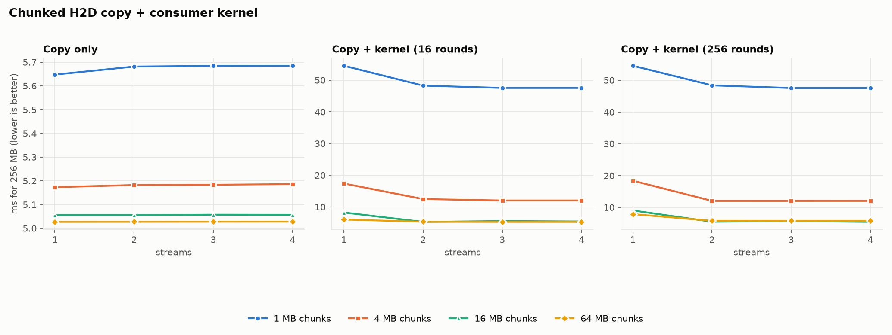](microbenchmark/plots/11_stream_overlap.png) | **Device malloc vs bump arena**<br>[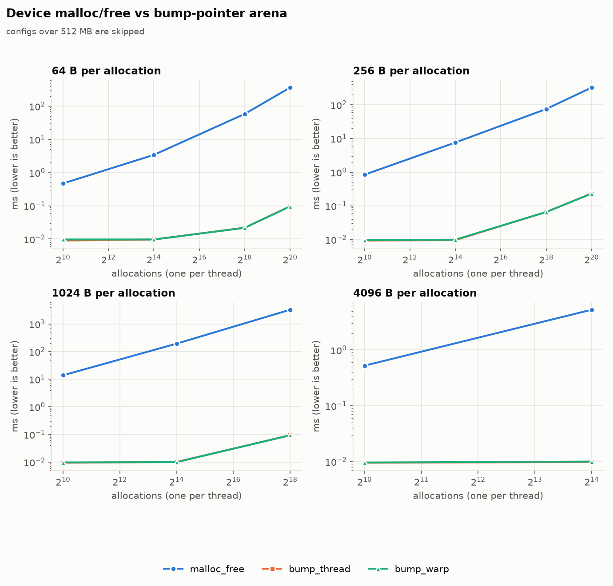](microbenchmark/plots/12_arena_alloc.png) |
| **Tensor-core equality**<br>[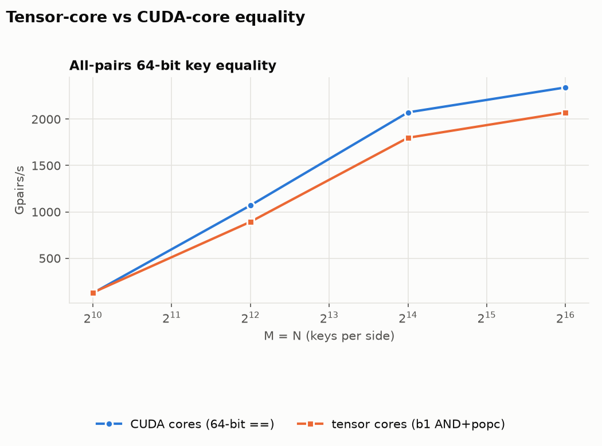](microbenchmark/plots/13_bmma_equality.png) | **L2 compression of padding**<br>[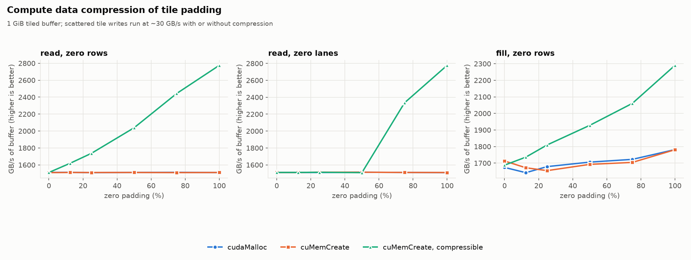](microbenchmark/plots/14_l2_compression.png) |

Numbers are single runs on a shared GPU, so gaps of a few percent are noise.

---

## Layout

Two self-contained projects, each with its own `CMakeLists.txt`, `include/` and `src/`. Drivers are short
lists of named steps, one small file per step.

```
G-HUIM/   GPU miner: src/app (CLI, main steps), src/data (loading), src/mine/{bfs,dfs} (engines)
REFIM/    CPU miner: src/app (options, run), src/io (reader steps), src/mine (search, workers), src/sys
experiments/   benchmark, comparison and plotting scripts
microbenchmark/   14 single-purpose CUDA micro-benchmarks with a runner and plot script
```

---

## Formatting

```bash
find G-HUIM REFIM -type f \( -name '*.hpp' -o -name '*.cuh' -o -name '*.cpp' -o -name '*.cu' \) -print0 | \
  xargs -0 clang-format -i
```

---

## Datasets

`python3 experiments/download_datasets.py` fetches the SPMF utility datasets into `datasets/` (`--only chess,connect`
for a subset, `--all` for extras). They come from
https://www.philippe-fournier-viger.com/spmf/index.php?link=datasets.php.
Each line is a transaction: items, total utility, then item utilities.
